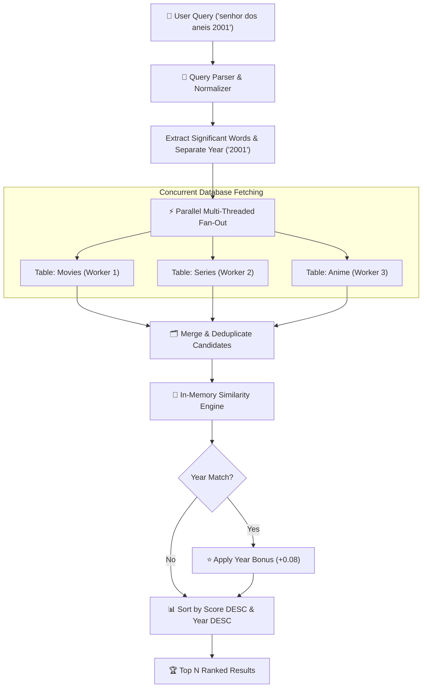

<div align="center">

# 🔎 fuzzytitles
### Forgiving, Fast & Database-Agnostic Title Search for Media, Catalogs & E-Commerce

[](https://python.org)
[-green.svg)](https://github.com/Kaio-Comk/fuzzytitles)
[](https://docs.python.org/3/library/concurrent.futures.html)
[-orange.svg)](https://github.com/Kaio-Comk/fuzzytitles)
[](https://opensource.org/licenses/MIT)

**Stop losing users to typos, accents, missing words, and trailing years.**  
*Plug in your existing database query function and get instant, parallel, ranked fuzzy search.*

[The Problem](#-why-fuzzytitles) • [How It Works](#-search-pipeline) • [Installation](#-installation) • [Quickstart](#-quickstart) • [PostgreSQL Trigrams](#-typo-tolerance-with-postgresql-trigrams) • [Contributing](#-contributing)

</div>

---

## ⚡ Why fuzzytitles?

Standard database searches (`ILIKE '%query%'` or `WHERE title LIKE ?`) fail on real-world human input:

| User Query | Target in Database | Standard SQL `ILIKE` | `fuzzytitles` Result |
|---|---|:---:|:---:|
| `interestellar 2014` | *Interestelar* (2014) | ❌ 0 results (typo `ll` vs `l`) | ✅ **Found & Ranked #1 (Score: 0.98)** |
| `senhor dos aneis` | *O Senhor dos Anéis* | ❌ 0 results (missing accent) | ✅ **Found & Ranked #1 (Score: 0.96)** |
| `spider man no way home`| *Spider-Man: No Way Home*| ❌ 0 results (missing punctuation)| ✅ **Found & Ranked #1 (Score: 0.95)** |
| `inception 2010` | *Inception* | ❌ 0 results (year included) | ✅ **Found & Ranked #1 (Year bonus applied)**|

---

## 🏗️ Search Pipeline



---

## 📦 Installation

```bash
pip install git+https://github.com/Kaio-Comk/fuzzytitles.git
```

---

## 🚀 Quickstart

Works with **any database client** (Supabase, SQLAlchemy, asyncpg, psycopg, sqlite3, or pure Python lists). All you do is provide a 2-line `fetch` function:

### Example: Supabase / PostgreSQL
```python
from fuzzytitles import search
from supabase import create_client

sb = create_client("https://xyz.supabase.co", "YOUR_KEY")

def fetch(table: str, term: str, limit: int):
    # Runs in parallel threads across tables & keywords
    res = (
        sb.table(table)
        .select("id, title, year, poster_url")
        .ilike("title", f"%{term}%")
        .limit(limit)
        .execute()
    )
    return res.data or []

# Search movies and series simultaneously with typo & year handling
results = search(
    fetch,
    query="senhor dos aneis 2001",
    tables=["movies", "series"],
    limit=20,
    title_key="title",
    year_key="year"
)

for item in results:
    print(f"[{item['_tabela']}] {item['title']} ({item.get('year')}) — Score: {item['_score']:.2f}")
```

---

## 🔍 Typo Tolerance with PostgreSQL Trigrams

To handle severe typos (e.g., `interestellar` ➔ `Interestelar`), pair `fuzzytitles` with PostgreSQL's `pg_trgm` extension using the included migration:

```bash
# Check the included SQL migration:
sql/001_trigram_search.sql
```

Then hook it up via RPC:
```python
fetch = lambda table, term, n: sb.rpc(
    "search_titles", {"p_table": table, "p_term": term, "p_limit": n}
).execute().data or []
```

---

## 🛡️ Production Fault Tolerance

* **Isolated Failures:** If one table query times out or fails, `on_error` is triggered and the remaining tables continue seamlessly without crashing the search.
* **Multilingual Stopword Stripping:** Automatically removes noise words across English, Portuguese, Spanish, and French (e.g. *the, a, o, a, de, el, la, le*).
* **Zero Database Overhead:** Ranking, fuzzy scoring, and deduplication run entirely in-memory inside lightweight Python worker threads.

---

## 🧪 Testing

```bash
pip install -e ".[dev]"
pytest -v
```

---

## 📄 License

Distributed under the **MIT License**. See `LICENSE` for details.

<div align="center">
  <sub>Built with ❤️ by Kaio Lima. If fuzzytitles improved your search experience, please star ⭐ the project!</sub>
</div>
